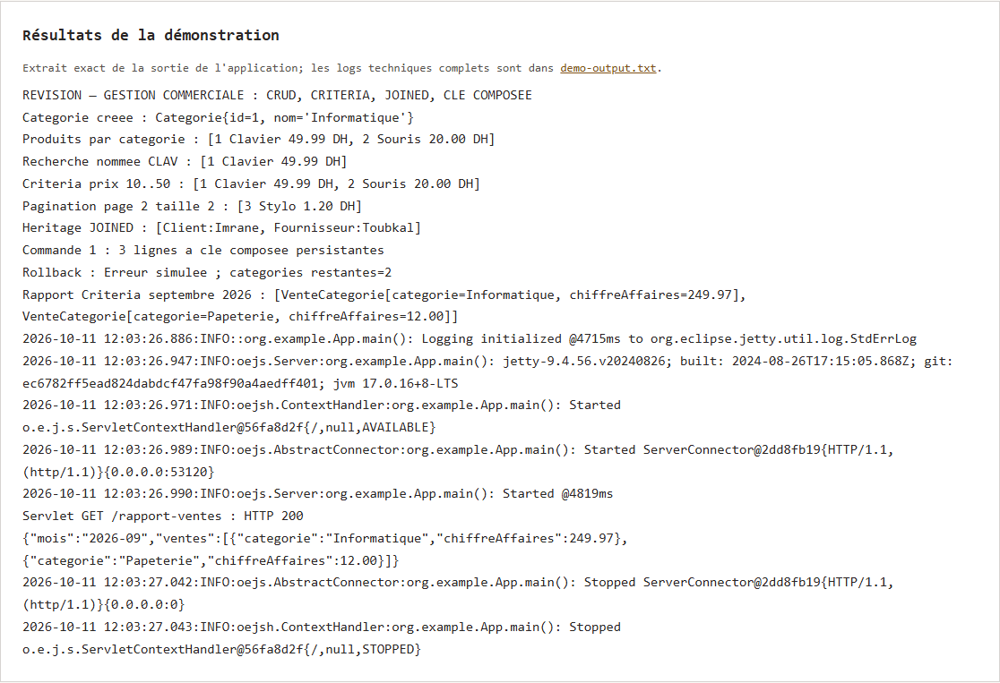
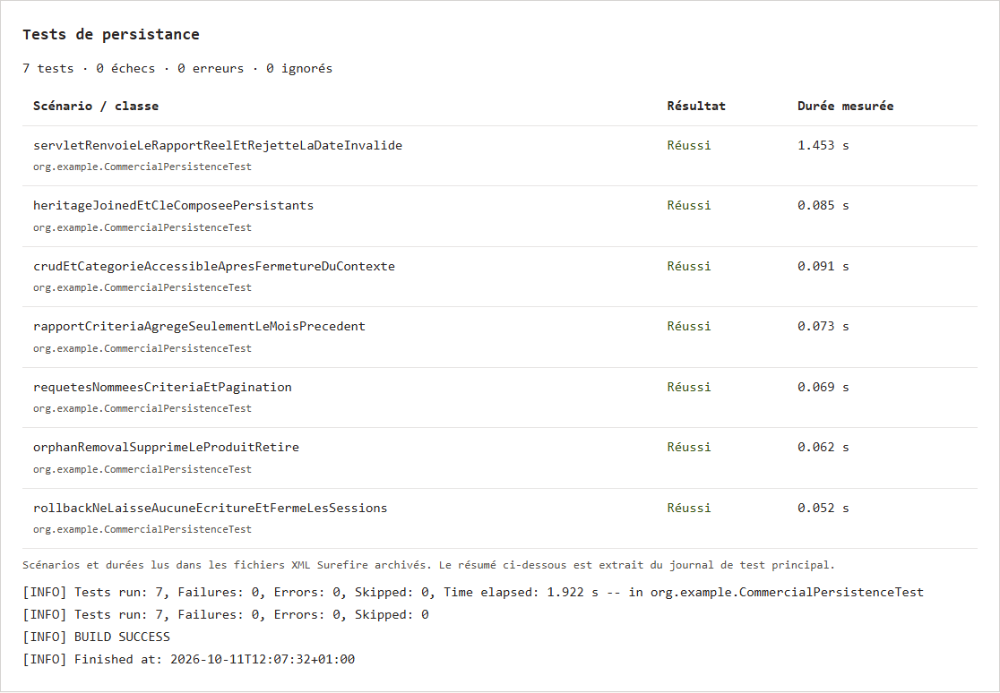
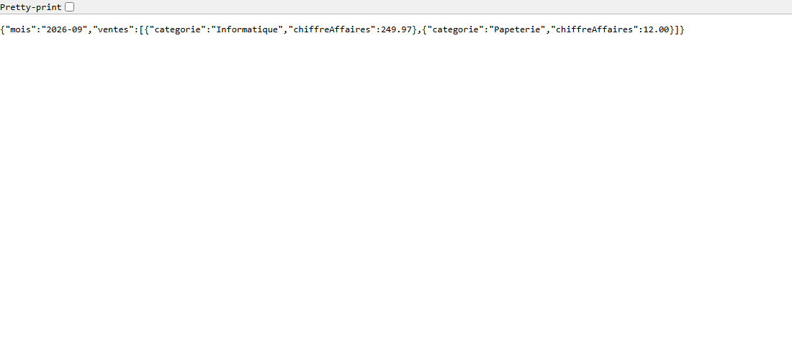

# Révision — Gestion commerciale avec Hibernate & JPA

Solution complète du lab **407** du [cours Hibernate & JPA](https://mliaedu.toubkalit.com/student/courses/28), y compris le rapport mensuel demandé dans l'exercice de synthèse. Java 17, Hibernate **5.6.15.Final**, JPA **2.2**, MySQL Connector **8.0.33**, JUnit **4.13.2**. La table ci-dessous décrit les exigences couvertes.

## Exécution

```bash
mvn clean test package
mvn exec:java
```

La démonstration autonome utilise H2 en mémoire, insère ses données, appelle réellement le servlet HTTP et se termine. Le WAR produit est `target/gestion-commerciale-1.0.0.war` et peut être déployé dans un conteneur Servlet 4/Java EE 8.

Pour garder le serveur de démonstration ouvert :

```bash
mvn compile exec:java -Dexec.args=--serve
```

Ouvrir [le rapport de septembre 2026](http://127.0.0.1:8087/rapport-ventes?date=2026-10-11). Arrêter avec Ctrl+C. Sans paramètre `date`, le servlet utilise la date courante dans `Africa/Casablanca`. Une date invalide retourne HTTP 400.

La connexion MySQL est facultative : créer une base `gestion_commerciale`, définir `DB_URL`, `DB_USER`, `DB_PASSWORD`, puis lancer `mvn -Ddb=mysql exec:java`. La configuration emploie `MySQL8Dialect` et `hbm2ddl.auto=update`. La démonstration H2 et les tests sont les exécutions vérifiées dans ce dépôt.

## Fonctionnalités demandées

| Étape | Implémentation |
|---|---|
| Configuration | `hibernate.cfg.xml`, `org.example.util.HibernateUtil`, singleton partagé par l'API JPA et Hibernate |
| CRUD | `GenericDAO<T,ID extends Serializable>` et `CrudService<T,ID>`, rollback et fermeture systématique de l'EntityManager |
| Catégories / produits | `Categorie`, `Produit`, relation bidirectionnelle, helpers et suppression des orphelins |
| Requêtes | `Produit.findAll`, `findByCategorie`, `searchByLibelle`, Criteria avec filtres optionnels et pagination ordonnée |
| Héritage | `User` abstrait, `Client` et `Fournisseur`, stratégie `JOINED` |
| Association N:N | `Commande`, `CommandeProduit`, `CommandeProduitPK`, `@EmbeddedId` et `@MapsId`, quantités positives et paire unique |
| Transactions | Opération atomique sur plusieurs entités, rollback démontré, contextes limités à une unité de travail |
| Synthèse | `RapportVentesService`, somme `prix × quantité` par catégorie avec **Criteria API**, exposée par `RapportVentesServlet` |

`CommandeService` rattache les produits existants au contexte avant de persister les lignes `@MapsId`. Le DAO reste générique. Les lectures devant accéder à une catégorie après fermeture utilisent `JOIN FETCH`, ce qui corrige le problème de contexte fermé dans l'exemple du sujet. Le singleton `SessionFactory` implémente également `EntityManagerFactory` : aucune seconde factory non configurée n'est créée. Le listener web ferme la factory à l'arrêt du conteneur.

Le rapport utilise l'intervalle **[premier jour du mois précédent, premier jour du mois courant[**. La démonstration fige la référence au 11 octobre 2026 pour être reproductible ; les données du rapport datent de septembre 2026. Le prix utilisé est le prix actuel du produit, conformément à la formule du sujet ; un historique de prix nécessiterait un champ supplémentaire sur la ligne de commande.

## Résultats vérifiés

**7 tests de persistance/HTTP passent, sans erreur ni test ignoré** : CRUD détaché, recherches/pagination, rollback et fermeture des sessions même après une violation d'unicité, héritage/clés composées, `orphanRemoval`, bornes mensuelles et réponses du vrai servlet Jetty (200/400). `mvn test package` produit également le WAR avec succès.

La démonstration retourne les produits `Clavier`, `Souris`, `Stylo`, les deux sous-types d'utilisateur, une commande à 3 lignes, un rollback laissant 2 catégories et le rapport suivant, reçu via HTTP 200 :

```json
{"mois":"2026-09","ventes":[{"categorie":"Informatique","chiffreAffaires":249.97},{"categorie":"Papeterie","chiffreAffaires":12.00}]}
```

Les preuves sont [la sortie réelle de démonstration](evidence/demo-output.txt) et [la sortie des tests/build](evidence/test-output.txt). Les deux premières captures sont un rapport navigateur issu des preuves sauvegardées ; la troisième montre la réponse du servlet en cours d'exécution.







## Références

[Guide officiel Hibernate 5.6](https://docs.hibernate.org/orm/5.6/userguide/html_single/) ; [Java EE — Criteria API](https://javaee.github.io/tutorial/persistence-criteria.html) ; [Java EE — Servlets](https://javaee.github.io/tutorial/servlets.html).

## Régénérer le rapport et les captures

Les images sont des captures navigateur de résultats réellement exécutés, conservés dans `evidence/`. Les tests proviennent des XML Surefire, également archivés dans `evidence/junit/`. Les empreintes SHA-256 des sources figurent dans `evidence/checksums.json`.

Avec Python 3 et Node.js disponibles, depuis la racine du dépôt :

```sh
mvn clean verify > evidence/test-output.txt 2>&1
mvn exec:java > evidence/demo-output.txt 2>&1
python scripts/generate_report.py
npm install --no-save playwright
npx playwright install chromium
node scripts/capture-results.cjs
```

Le rapport se consulte aussi directement dans `evidence/report.html`. Les captures générées sont `screenshots/results.png` et `screenshots/tests.png`.
